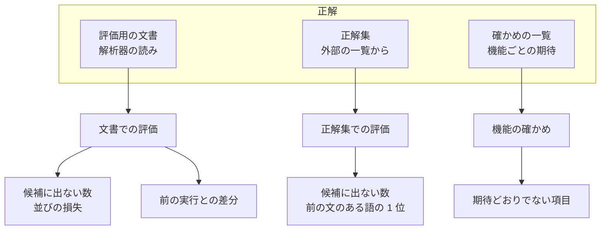
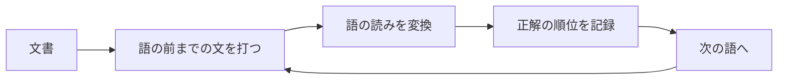
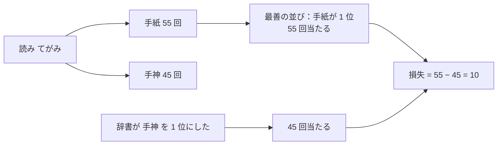

# 評価

辞書と並べ替えのモデルを、Kanaemi で変換して測る。評価の数字で、素材の足し引き、足切りの回数、単位の切り方、コストの付け方、モデルの学習の仕方を決める。

- 最も重いのは、書きたい語が **候補に出ない** こと。
- 並びは、文脈を見ない最善の並びと比べた **損失** で測る。同じくらい使われる同音異義語の入れ替わりは損失が小さく、圧倒的に多い語を落とすと損失が大きい。

どう決めるかは [評価は、候補に出ない語と、文脈なしの最善の並びに対する損失で測る](../adr/20261012-measure-missing-words-and-the-loss-against-the-best-order.md) による。

## 全体

- 評価用の文書は、辞書にもモデルにも使わない。
- 評価用の文書の正解は解析器の読みなので、解析器の誤りは見えない。それを正解集と、別の解析器と読みが一致する単位で測った値で補う。

## 文書での評価

### 打つ単位

打つ単位は、解析器の区切りだけで決める。どの辞書も同じ単位を打つ。

- 解析器がまとめる複合語は、1 回で打つ。その中の単位は打たない。
- 重なる複合語は、先に始まるもの、同じ所から始まるなら長いものを打つ。単位が外へはみ出す複合語（社会主義 と、定着した 主義的）は 1 回で打たず、その中の単位を打つ。はみ出すかどうかは、下の接辞の決まりで分けた後の単位で見る（まれな 主義的 は 主義 と 的 に分けるので、社会主義 を 1 回で打ち、的 を打つ）。
- 接頭辞・接尾辞をつないだ単位は、つないだ語が語彙（UniDic と SudachiDict の語彙全体）にあるか、学習用の文書の複合語の外に辞書の足切りの回数以上出れば 1 回で打ち（日本人、皆さん）、どちらでもなければその中の変換の要る語に分けて打つ（寺島さん は 寺島 を打ち、さん は変換しない）。打つ人は、語として定着した語を 1 語で、そうでない組み合わせを分けて打つ。定着の判断は学習用の文書と足切りの回数で決まるので、辞書どうしを比べるのは、この二つが同じときに限る。どちらかが変わると打つ単位が変わり、値はそのまま比べられない。
- 活用する語は、送り仮名の最初のかなまでを打つ（書いた は か*い）。
- 単位を、語（`word`）、複合語（`compound`）、数を含む単位（`numeric`）、送り仮名の揺れの表記（`variant`、分らない）に分けて測る。送り仮名の揺れの表記は、基本辞書が出さずに揺れの追加辞書に置くものなので、全体（`all`）の数字には入れない。

- 語の前までの文は打つが、確定はしない。確定した語が次に先に出るのは Kanaemi の学習で、辞書では変えられない。モデルは前の文を手がかりにする。
- 候補は、変換の結果の後ろに、結果になければ読みのカタカナを足したもの。

### 並びの損失

- 読み（打つ形）ごとに、評価用の文書でいちばん多く書かれた表記を 1 位に置く並びを、文脈を見ない最善の並びとする。最善の並びが 1 位にする単位の数から、実際に 1 位になった単位の数を引いたものが損失。
- 0 より小さい損失は、前の文を手がかりに、最善の並びより多く当てたことを表す。
- 1 ページ目（9 位まで）についても、最善の並びが 9 位までに置く単位の数と比べて、同じように損失を出す。
- 候補に出なかった単位は、候補に出ない単位とだけ数え、並びの損失には入れない。
- 数を含む単位は、数の値は区別せず、数の書き方と後ろの語で数える。3階 も 5階 も「数字＋階」、三階 は「漢数字＋階」、3回 は「数字＋回」として、別々に数える。

### 別の解析器と読みが一致する単位

正解の読みのうち、どれだけが解析器の誤りかを見積もるため、別の系統の解析器（MeCab と IPAdic）が表記を同じに読む単位だけでも同じ数字を出す。数を含む単位は、MeCab が数字を 1 字ずつ読むので入れない。人が判定するため、候補に出なかった単位を決まった数だけ、毎回同じものを抜き出す。

### 出力

`just evaluate` はモデルなしで、`just ranking` はモデルを学習してモデルありで、次のものを `build/` に書く（モデルありは `ranking-` で始まる名前）。

| ファイル | 中身 |
| --- | --- |
| `evaluation.tsv` | 出典の種類と単位の分類ごとの、単位の数、候補に出ない数、1 位の数、最善の並びの 1 位の数、損失、9 位までについて同じもの。出典の種類のあとに全体（`all`）、別の解析器と読みが一致する単位（`agreed`）を並べる |
| `evaluation-misses.tsv` | 候補に出なかった単位を、読みと正解の表記ごとに、そのとき 1 位に出たものとともに、多い順に |
| `evaluation-losses.tsv` | 損失のある読みを、最善の並びの 1 位の表記と、実際に 1 位に出たものとともに、損失の大きい順に |
| `evaluation-keys.tsv` | すべての読みの数字。次の実行と比べるのに使う |
| `evaluation-diff.tsv` | 前の実行から、候補に出ない数か損失が変わった読みを、変わった量の大きい順に |
| `evaluation-missing-sample.tsv` | 候補に出なかった単位の抜き出し（モデルなしだけ） |

## 正解集と確かめの一覧

[辞書の確かめ](checks.md#正解集) に書く。
